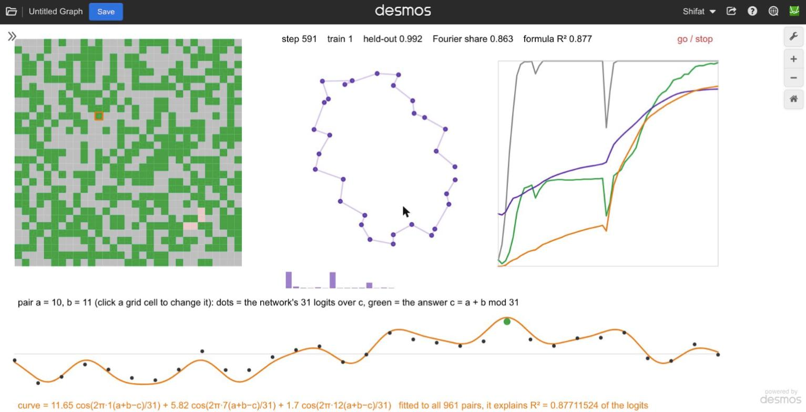

# Transformers inside Desmos

Two transformers that run entirely inside the [Desmos](https://www.desmos.com/calculator) graphing calculator, every multiply, softmax and gradient a Desmos expression:

- **One writes text.** A 105k-parameter character-level transformer, trained offline on Homer, runs in the graph: type a prompt on the keyboard drawn there, press go, and it writes about 5 characters per second while a panel shows where each attention head is looking. Switch a head off and the text changes. Its outputs match a float64 numpy reference to 1e-14.
- **One learns.** A one-layer transformer trains from scratch inside Desmos (forward pass, hand-written backward pass, AdamW, one step per tick) on (a + b) mod 31 and groks: it memorizes, sits on a 42% plateau, then generalizes to 99%. The same graph reads the algorithm it found back out as a formula, a sum of three waves cos(2 pi k (a + b - c) / 31), and lets you delete it: without those waves the grokked network can no longer add.

Python only trains the text model offline, writes the expressions, and checks the numbers.



Status: works (2026-10-22). Live graphs (open one, collapse the expression list, click "go / stop"):

- https://www.desmos.com/calculator/cymoybusyq ("LM: Homer in a calculator, heads exposed"): the text generator, 4x faster, with the attention panel and head switches.
- https://www.desmos.com/calculator/itatkskgam ("LM: a transformer learns to add, inside a calculator"): the training graph that groks (a + b) mod 31, with the formula panel and the ablation buttons.
- https://www.desmos.com/calculator/yy7jpv4xd3 ("LM: Homer in a calculator"): the first version of the text generator, kept as it was.

## Where it stands

| Step | Result |
|---|---|
| Model | 2 layers, d_model 64, 2 heads of 32, MLP 256, 32-character window, RMSNorm, GELU, learned positions, 105k parameters, 32-symbol vocabulary (lowercase, space, `. , ; ' "`). Trained offline on Samuel Butler's prose Odyssey and Iliad: 1.76 bits per character on held-out text. See [`experiments/charlm/`](experiments/charlm/). |
| Exact in Desmos | For a fixed 32-character input, all 1,024 logits from the Desmos graph match the float64 numpy reference to 2.3e-14 (largest logit 14.7). During generation, after the window had slid past 32 characters, the next-character logits matched numpy to 3.3e-15. |
| Generates text | From the prompt "then minerva said, " the graph writes `"then menelaus, where he said,` (the graph's random seed is pinned, so two fresh loads write the same text). About 5 characters per second on a 15 W laptop with the tab in front (4.7 to 6.3 across runs): a forward pass takes 140 to 190 ms, and the attention panel adds no measurable cost. See [`experiments/gen-speed/`](experiments/gen-speed/). |
| Inside the model | A panel shows, for each of the 4 heads, how much attention the newest character pays to each of the last 32, live as it writes, and clicking a head's caption switches it off (its output times 0, exact). Measured on held-out text: layer 1 head 2 puts 69% of its attention on the character just before, and without it the model scores 4.86 bits per character instead of 1.78; layer 2 head 2 puts 43% on spaces (where words start). With a head off, the graph's logits match numpy with that head removed to 3e-14. Stats from [`experiments/charlm/head_stats.py`](experiments/charlm/head_stats.py). |
| Trains in Desmos too | A one-layer transformer trained from scratch inside Desmos (hand-written backward pass, AdamW, one step per tick) grokked (a+b) mod 31: 42% held-out plateau, then 99.17% at step 587, with the Fourier circle forming in the graph. The same graph fits the algorithm back out as a formula, sum of alpha_k cos(2 pi k (a+b-c)/31), every step: its share of the network's output tripled during the plateau while accuracy stood still, and reached 0.877 at grokking. A button removes those waves from the network's output: the grokked network then gets 4.6% of held-out pairs right (the waves alone: 99.6%). See [`experiments/grok-desmos/`](experiments/grok-desmos/). |
| How it fits | Desmos matrices stop at 32x32, so every weight is cut into 32x32 blocks and every activation is a list of blocks. Each attention head is exactly one 32-column block. Lists of matrices are never rendered in the expression list, so the forward pass is not slowed by display. |

Evidence (screenshots, measured numbers) is in [`evidence/`](evidence/), indexed in [`evidence/LOG.md`](evidence/LOG.md).

## Try it

The quickest way is the live graphs above. To build them yourself you need Python 3 with numpy (and pytest for the tests; PyTorch only to retrain or to run the tests that compare against it).

```bash
python3 gen_desmos.py out/lm.json --prompt "then minerva said, "
```

Open https://www.desmos.com/calculator, open the browser console, and run `Calc.setState(` followed by the contents of `out/lm.json` and `)`. Collapse the expression list (it makes ticks much cheaper), then click "go / stop". The keyboard keys are clickable: they append to the text, and their shading is the model's probability for each next character. The temperature `\tau_s` and seed `s_d` sliders are in the expression list.

To check the numbers yourself: `python3 gen_desmos.py out/lm_ref.json` builds the graph for the reference input in `experiments/charlm/best/reference.npz`; compare the graph's `Y` (flatten with `[Y[1][a;b] for a=[1...32],b=[1...32]]`, column-major) with the reference `logits`.

The training graph is built by `experiments/grok-desmos/gen_grok.py`; its README has the steps, from the numpy reference run to the graph and the numbers to check it against.

## Layout

- `gen_desmos.py`: weights to a Desmos graph state (model, sampler, text display, keyboard). `test_gen_desmos.py` pins its block layout.
- `desmos_passes.py`: passes over a graph shared by both generators, chiefly `materialize`, which keeps Desmos from re-deriving lists (generation 4x faster; the training graph's first evaluation from over 4 minutes to 3 s).
- `experiments/charlm/`: training, the size-versus-quality study, the numpy reference forward pass, exported weights.
- `experiments/grok-desmos/`: the training graph generator, the numpy reference step (checked against PyTorch autograd), the formula fit and wave ablation; `experiments/grokking/`: the offline study that picked the run.
- `experiments/attention-bench/`, `experiments/ticker-bench/`, `experiments/gen-speed/`: the engine measurements that shaped the design.

## Prior work

Transformers in odd substrates (Excel, SQL, a font, Scratch, a Casio calculator as native code) are an established genre, and a single random-weight attention block already exists in Desmos (https://www.desmos.com/calculator/0kqb05bq4i). We found no earlier language model, of any kind, running inside Desmos; that search was moderate in strength (reddit only partly reachable, X and Discord not at all).

## Credits

Built by Claude (Anthropic's Claude Opus 5.5, working in Claude Code), directed by Shifat Islam Santo: he chose the goals, made the calls and checked the results; Claude wrote the code, ran the experiments and drove Desmos.

## License

MIT, see [LICENSE](LICENSE). Author: Shifat Islam Santo ([@oneKn8](https://github.com/oneKn8)).
